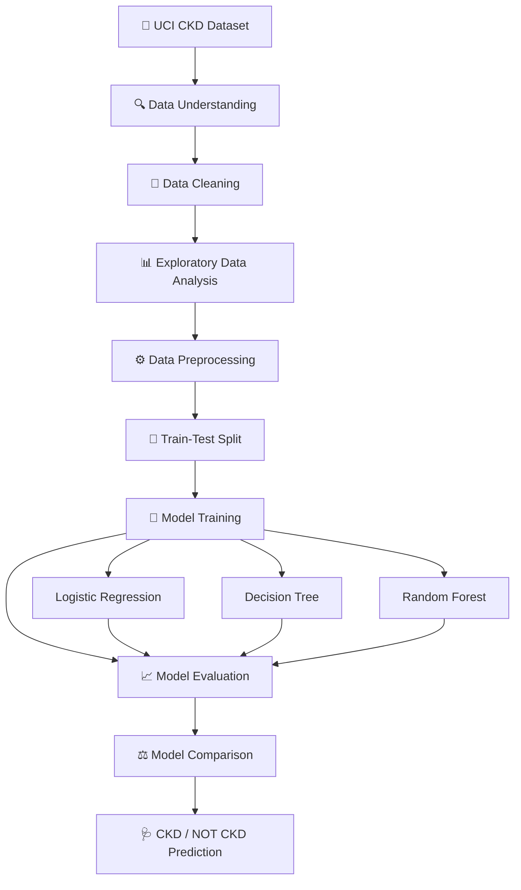

# 🧠 CKD PREDICTOR
### 🩺 Turning Clinical Data into Machine Learning Insights

<div align="center">

**CAN MACHINE LEARNING HELP IDENTIFY CHRONIC KIDNEY DISEASE?**

An end-to-end machine learning project that explores clinical and demographic patient data to predict Chronic Kidney Disease (CKD).

From data cleaning and exploratory analysis to model training and evaluation — this project demonstrates how healthcare data can be transformed into meaningful machine learning insights.

**🔬 Explore the Data. 🤖 Train the Models. 📊 Evaluate the Results.**

</div>

---

## 🚀 PROJECT OVERVIEW

Chronic Kidney Disease (CKD) is a significant healthcare challenge, and identifying patterns in clinical data can support research into early disease detection.

This project applies supervised machine learning classification techniques to the **UCI Chronic Kidney Disease dataset** to distinguish between patients classified as having CKD and those classified as not having CKD.

The complete workflow is implemented in a Jupyter Notebook using Python and Scikit-learn.

### 🎯 Project Highlights

- 📊 Analyzed **400 patient records** with 24 input features.
- 🧹 Performed data cleaning and missing-value treatment.
- 🔍 Conducted Exploratory Data Analysis (EDA).
- ⚙️ Applied categorical encoding and feature transformations.
- 🤖 Implemented Logistic Regression, Decision Tree, and Random Forest classifiers.
- 📈 Evaluated models using Accuracy, Precision, Recall, and F1-score.
- 🌳 Explored Decision Tree classification for CKD prediction.

---

## 🛠️ TECH STACK

| Category | Technologies |
|---|---|
| Programming Language | Python |
| Development Environment | Jupyter Notebook |
| Data Manipulation | Pandas, NumPy |
| Data Visualization | Matplotlib, Seaborn |
| Machine Learning | Scikit-learn |
| Algorithms | Logistic Regression, Decision Tree, Random Forest |

---

## 📂 DATASET

**Source:** [UCI Machine Learning Repository — Chronic Kidney Disease Dataset](https://archive.ics.uci.edu/dataset/336/chronic+kidney+disease)

The dataset contains 400 patient records and 24 input features representing clinical measurements, demographic information, and health conditions.

### 🩺 Feature Categories

| Category | Representative Features |
|---|---|
| Demographic | Age |
| Clinical Measurements | Blood Pressure, Blood Glucose, Blood Urea, Serum Creatinine, Hemoglobin |
| Urine Analysis | Specific Gravity, Albumin, Sugar, Red Blood Cells, Pus Cells |
| Clinical Conditions | Hypertension, Diabetes Mellitus, Coronary Artery Disease, Anemia |
| Other Indicators | Sodium, Potassium, Appetite, Pedal Edema, Bacteria |

### 🎯 Prediction Target

The target variable represents two classes:

- `ckd` — Chronic Kidney Disease
- `notckd` — No Chronic Kidney Disease

---

## 🔄 MACHINE LEARNING WORKFLOW

The project follows a structured machine learning pipeline:



---

## 🧹 DATA PREPROCESSING

Real-world clinical datasets often contain missing values, inconsistent categories, and mixed data types.

The preprocessing workflow includes:

- Identification and treatment of missing values.
- Cleaning inconsistent and invalid entries.
- Correction of data types.
- Removal of unnecessary columns.
- Encoding categorical variables.
- Numerical feature transformation.
- Feature scaling where required.
- Separation of input features and target variable.

---

## 📊 EXPLORATORY DATA ANALYSIS

EDA was performed to understand the dataset's structure, distributions, and relationships between clinical variables.

### Key Analysis Areas

- Dataset dimensions and statistical summaries.
- Missing-value distribution.
- CKD and non-CKD class distribution.
- Numerical feature distributions.
- Categorical feature analysis.
- Feature correlation analysis.
- Relationships between clinical indicators.
- Visualization of important features.

**Visualization Libraries:** Matplotlib and Seaborn.

---

## 🤖 MACHINE LEARNING MODELS

Three supervised classification algorithms were implemented and compared.

### 1. Logistic Regression

A baseline classification algorithm used to predict the binary CKD target.

### 2. Decision Tree Classifier

A tree-based algorithm that learns decision rules from clinical features to classify patients.

### 3. Random Forest Classifier

An ensemble learning algorithm that combines multiple decision trees to improve classification performance and generalization.

---

## 📈 MODEL EVALUATION

The trained models are evaluated using standard classification metrics.

| Metric | Purpose |
|---|---|
| Accuracy | Measures the proportion of correctly classified samples |
| Precision | Measures the proportion of positive predictions that are correct |
| Recall | Measures the proportion of actual positive cases identified |
| F1-score | Balances Precision and Recall |

### 🏆 Model Performance

The experiments explored Decision Tree performance across different configurations.

The reported accuracy varied approximately between **87% and 93%**, depending on the experimental configuration.

The Decision Tree classifier was identified as a strong-performing model in the experiments.

> Note: Performance metrics depend on the train-test split, preprocessing, and model configuration. These results represent an experimental machine learning project, not a clinically validated diagnostic system.

---

## 🧪 PREDICTION PIPELINE

The trained model follows this prediction workflow:

```text
        🩺 Patient Clinical Data
                  │
                  ▼
       ⚙️ Data Preprocessing
                  │
                  ▼
          🤖 Trained Model
                  │
                  ▼
        📊 Classification
                  │
          ┌───────┴───────┐
          ▼               ▼
       🩺 CKD         ✅ NOT CKD
```

The model generates a classification based on the patterns learned from the training dataset.

---

## 📓 NOTEBOOK STRUCTURE

The complete implementation is available in the Jupyter Notebook.

```text
CKD Prediction
│
├── Import Libraries
├── Load Dataset
├── Dataset Inspection
├── Data Cleaning
├── Missing Value Analysis
├── Exploratory Data Analysis
├── Data Preprocessing
├── Feature Encoding
├── Feature Scaling
├── Train-Test Split
├── Logistic Regression
├── Decision Tree Classifier
├── Random Forest Classifier
├── Model Predictions
├── Model Evaluation
└── Model Comparison
```

---

## ⚙️ INSTALLATION & SETUP

### Prerequisites

- Python 3.x
- Git
- Jupyter Notebook

### 1. Clone the Repository

```bash
git clone https://github.com/Bikash07-git/chronic-kidney-disease-prediction.git
```

### 2. Navigate to the Project Directory

```bash
cd chronic-kidney-disease-prediction
```

### 3. Create a Virtual Environment

```bash
python -m venv venv
```

### 4. Activate the Environment

**Windows**

```bash
venv\Scripts\activate
```

**Linux / macOS**

```bash
source venv/bin/activate
```

### 5. Install Dependencies

```bash
pip install pandas numpy matplotlib seaborn scikit-learn jupyter
```

Alternatively, if a `requirements.txt` file is available:

```bash
pip install -r requirements.txt
```

### 6. Launch Jupyter Notebook

```bash
jupyter notebook
```

Open `CKD_Prediction.ipynb` and execute the notebook cells sequentially.

---

## 🔮 FUTURE ENHANCEMENTS

The project can be extended with:

- [ ] Hyperparameter tuning using GridSearchCV or RandomizedSearchCV
- [ ] K-Fold cross-validation
- [ ] Advanced feature selection
- [ ] ROC-AUC and Precision-Recall curve analysis
- [ ] Feature importance analysis
- [ ] SHAP-based model explainability
- [ ] Additional classification algorithms
- [ ] Model serialization using Joblib
- [ ] Interactive prediction interface using Streamlit
- [ ] REST API deployment using FastAPI

---

## ⚠️ DISCLAIMER

This project is developed for educational and research purposes using a publicly available dataset.

The predictions are experimental and **must not be used for medical diagnosis, treatment decisions, or clinical recommendations**. Only qualified healthcare professionals can diagnose Chronic Kidney Disease.

---

## 👨‍💻 AUTHOR

### Bikash Sagar Koiri

*M.Tech CSE | Data Analytics | Machine Learning | AI & Research*

[](https://github.com/Bikash07-git)
[](https://www.linkedin.com/in/bikashsk26)

---

<div align="center">

### 🧠 DATA → INSIGHTS → PREDICTIONS

**⭐ If you find this project interesting, consider starring the repository!**

*Built with Python, Machine Learning, and a passion for solving real-world problems.*

</div>
